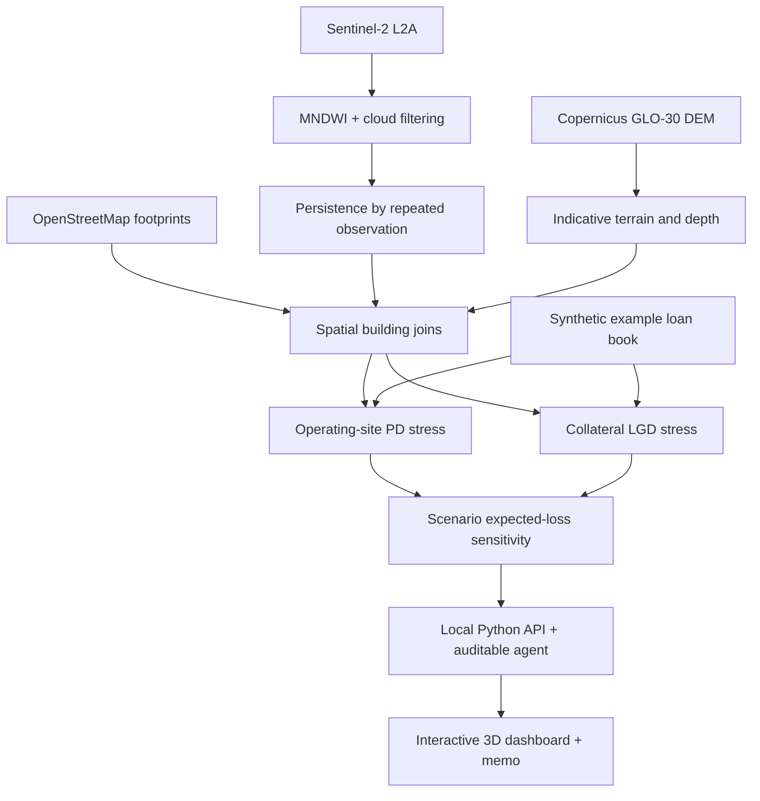

# 🌊 CLIMAX — Floods That Stay

   

> **UAE Hackathon 2026 · Central Bank of the UAE Climate-Risk Challenge**  
> A climate-credit risk prototype connecting satellite-observed flooding and water persistence to a simulated bank loan portfolio.

Banks can model how deep floodwater gets. **CLIMAX also asks how long water stays around a business — and what that could mean for its loan and collateral.**

## 🚀 Project Highlights

- **🛰️ Satellite pipeline:** Sentinel-2 L2A imagery, MNDWI-based water extraction, cloud checks and repeat-pass persistence measurements.
- **🏙️ Building-level view:** OpenStreetMap footprints, local three-dimensional extrusions and optional Cesium OSM Buildings basemap.
- **🏦 Two risk channels:** operational interruption → PD stress and collateral damage → LGD stress.
- **📍 Three Dubai case-study areas:** Al Quoz, DXB/Garhoud and Jebel Ali/Al Furjan.
- **🤖 Explainable query interface:** English/Arabic offline parser; optional Claude tool planner for private local use.
- **📑 Evidence and output:** scenario sliders, spatial validation, printable memo and downloadable JSON audit.

**Important data status:** The checked-in `data/generated/` directory is **TEST** data. It runs immediately, but these layers are not measured flood maps. A separately supplied REAL-run JSON audit is preserved in `evidence/` for reference only and is **not connected to this dashboard**. Run the full pipeline to create a spatially consistent REAL build. All loan records are synthetic in either mode.

## 🏗️ System Architecture



## 🛠️ Quick Start — Windows

1. Install [Python 3.11+](https://www.python.org/downloads/windows/).
2. Double-click **`START_WINDOWS.bat`** inside the extracted project folder.
3. Open **http://127.0.0.1:5173** in your browser.

That's it — no `npm install`, database, Docker, or API key. The included TEST demo is usable offline, including the MapLibre renderer. For the complete copy-paste GitHub/hosting walkthrough, see **[Windows → GitHub → Render](WINDOWS_GIT_DEPLOY.md)**.

To obtain real satellite layers, run `RUN_PIPELINE_WINDOWS.bat` with internet. This downloads and computes imagery/terrain/buildings using the packages in `requirements-pipeline.txt`. It is optional for previewing the app and may require substantial downloads.

### macOS / Linux

```bash
sh START_MAC_LINUX.sh
# To replace TEST datasets with REAL outputs, with network access:
sh RUN_PIPELINE_MAC_LINUX.sh
```

## ☁️ Deployment

For the complete API-backed site, deploy the repository to [Render](https://dashboard.render.com/) as a **Web Service** or apply the included `render.yaml` via **New → Blueprint**. `render.yaml` already sets the public binding and disables paid LLM calls on the public demo. GitHub Pages alone would not run the Python APIs.

- **Build:** `python -m compileall -q server.py engine.py agent.py memo.py pipeline`
- **Start:** `python server.py --no-browser`
- **Environment:** `HOST=0.0.0.0`, `CLIMAX_PUBLIC=1`
- **Health check:** `/api/health`

A public demo should not receive bank customer data. To use optional Cesium ion imagery, add your own browser-visible `CESIUM_ION_TOKEN` to the hosting environment and restrict it to your deployment domain. Do not expose a paid Anthropic token without authentication and rate limits.

## 📊 Evidence & Validation

The **standalone user-provided REAL audit** (`evidence/REAL_run_audit_REFERENCE.json`) reports the following *for its separate run*:

| Reference metric | Audit value |
|---|---:|
| Analyzed locations | 3 Dubai areas |
| Example loans | 140 (synthetic) |
| Total example exposure | AED 999.51M (synthetic) |
| Flagged loans | 27 |
| Stressed expected-loss change | AED 943,235 |

These are **not metrics of the TEST dashboard currently in the ZIP**, and are **not independent validation of bank performance**. The standalone audit records spatial holdout IoU values of 0.051 (Al Quoz), 0.075 (DXB) and 0.111 (Jebel Ali): the terrain-only forecast is a weak baseline, not a strong operational predictor. The aim is evidence-informed triage, not calibrated risk prediction.

### Methodology

| Layer | Input / method | Interpretation |
|---|---|---|
| Water extent | Sentinel-2 L2A; MNDWI with thresholding | Optical remote-sensing proxy; cloud-sensitive |
| Duration | Last clear satellite pass showing water | **Lower bound** on persistence, not continuous measurement |
| Building contact | 15 m ring around OSM footprints | Exposure proxy, not confirmed interior damage |
| Depth | Simplified FwDET using Copernicus DEM GLO-30 | **Indicative**, not an engineering-grade flood model |
| Pre-storm terrain model | Priority-Flood + topographic position | Baseline, tested on a spatial holdout |
| Loans / PD / LGD / insurance | Seeded illustrative portfolio | **Synthetic**, not real bank records |

### Risk mechanics (illustrative)

```text
PD_stressed  = min(PD × cap, PD × (1 + β × interruption_days))
LGD_stressed = min(100%, LGD + uninsured collateral damage / EAD)
ΔEL          = EAD × (PD_stressed × LGD_stressed − PD × LGD)
```

It is **not** an IFRS 9 Expected Credit Loss estimate, a regulatory capital number, nor a validated PD/LGD model. The coefficients and damage functions require institution-level calibration.

## 🖥️ Demo Workflow

1. Click **▶ PLAY STORY** for the guided flood narrative.
2. Switch between **WATER**, **HOW LONG**, **DEPTH**, and **FORECAST vs REALITY**.
3. Adjust the PD stress slider and select **NEXT STORM** to explore sensitivity.
4. Ask questions such as *Which uninsured loans remained exposed?*; inspect the tool trace and building highlights.
5. Export the **MEMO** and **AUDIT** to inspect assumptions and output.

## 📁 Project Structure

```text
index.html, assets/          Dashboard, map engines, prebuilt client assets
server.py                    Local / hosted Python HTTP API
engine.py                    Scenario finance calculations
agent.py                     Auditable offline / optional Claude query planning
memo.py                      Printable credit-risk committee memo
pipeline/                    Satellite, DEM, OSM and loan simulation pipeline
data/generated/              Built-in labelled TEST demo raster + GeoJSON layers
evidence/REAL_run_audit_REFERENCE.json   Supplied separate REAL-run audit
tests/                       Unit / offline pipeline tests
render.yaml                   Render hosting configuration
START_WINDOWS.bat             Launch the built-in demo on Windows
RUN_PIPELINE_WINDOWS.bat      Optional REAL data pipeline
WINDOWS_GIT_DEPLOY.md         Full Windows Git and cloud deployment guide
```

## ✅ Verification

- 23 Python unit/integration tests were run and passed on this checkout.
- The local API and HTTP routing checks are documented in [TESTS_AND_RESULTS.md](TESTS_AND_RESULTS.md).
- Browser rendering in this sandbox, remote Sentinel-2 retrieval, live Cesium ion terrain/buildings and public Render deployment have **not** been independently confirmed for this packaged revision.

## ⚠️ Limitations & Data Ethics

This is a research/hackathon demonstrator, **not a lending decision engine**. Published layers may be TEST, the loan book is synthetic, satellite revisit/clouds limit water persistence resolution, and DEM-based depths and the baseline forecast contain substantial uncertainty. Do not paste private bank records into a public demo or treat its financial outputs as evidence of actual losses.

Third-party JavaScript and map data retain their own licenses. See `assets/vendor/` for upstream notices; OpenStreetMap is ODbL and Copernicus data are subject to their attribution terms. No blanket MIT license is asserted for third-party assets.

## 🤝 Credits

Developed as a UAE Hackathon climate-risk prototype. Satellite inputs: Copernicus Sentinel-2, Copernicus DEM; building footprints: OpenStreetMap; STAC discovery: Element 84 Earth Search. Optional 3D basemaps: Cesium ion.

---

*⭐ If this demonstration is useful, star the repository. Include the TEST/REAL provenance when showcasing results.*
